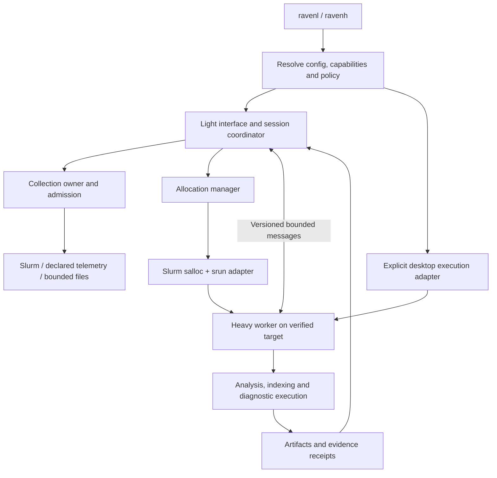
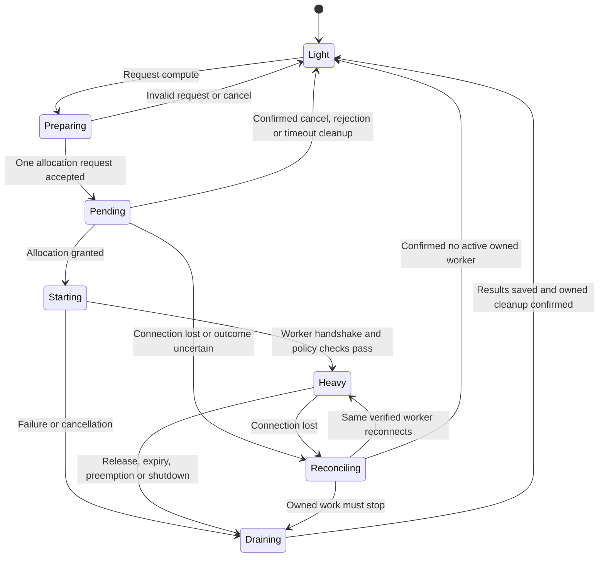

# Raven architecture and deployment specification

**Release scope:** 7.0.0 and Unreleased updates. **Public launchers:** `ravenl` for Light and `ravenh` for Heavy.
**Audience:** maintainers, cluster administrators, testers, and release engineers.

This specification defines execution ownership, Light and Heavy profiles, allocation control,
collection budgets, configuration, compatibility, and deployment acceptance. The numbered
requirements preserve the original design traceability. A requirement states the intended
contract; its presence does not establish implementation or qualification. The [implementation
map](../raven/implementation.md) identifies the released owners and unsupported cases. The
[validation record](../raven/validation.md) reports measured results and their limits.

Raven 7.0.0 implements the persistent Light interface, admitted Heavy workers, private
host-local collection coordination, configuration, and migration contracts. Local validation
covers real desktop processes and PTYs, installed artifacts, deterministic allocation faults,
and synthetic collection cohorts. Real Slurm sites, authenticated production SSH, devices, and
deployment capacity require separate qualification. Neither this specification nor local
evidence certifies universal Slurm compatibility or negligible overhead.

| Design area | Release 7.0.0 scope | Evidence or remaining work |
| --- | --- | --- |
| Launchers, configuration, and packaging | Implemented `ravenl`, `ravenh`, and Light `raven` commands; accepted `raven.config/v1`; one `raven` distribution and import namespace | [Implementation map](../raven/implementation.md) and [installed-package validation](../raven/validation.md#distribution-and-terminal-checks) |
| Light ownership and resource admission | Implemented collection and retention limits; numerical performance goals assessed separately | Monitoring CPU and RSS goals pass the local fixture; the 1% idle CPU goal remains unmet |
| Heavy placement and allocation lifecycle | Implemented desktop process and Slurm CLI adapters with verification and owned cleanup | Real desktop and synthetic fault evidence; real Slurm placement remains untested |
| Advanced workflows | Named worker handlers and explicit execution contracts | External drivers, instrumentation, and mutation adapters retain their declared prerequisites |
| Cluster observation service and full-interface transfer | Unsupported by the released adapters | Design extensions only; unsupported configuration or launch requests are rejected |
| Aggregate hard enforcement and production scale | No portable aggregate cgroup guarantee or production capacity claim | Site enforcement, multi-hour soaks, and administrator-approved cohorts remain required |

Read sections 1, 5–6, 8, and 11–13 for product and interface contracts; sections 3, 7, 10, and
17–18 for deployment; and sections 4, 9, and 14–16 for implementation ownership and acceptance
gates. Section 19 maps the requirement identifiers.

## 1. Decisions and product contract

| Decision | Required behavior |
| --- | --- |
| Product name | Use **Raven** in product identity, distribution, imports, commands, configuration paths, and current evidence schema identifiers. |
| Light launcher | `ravenl` starts the bounded Light experience without requesting an allocation. |
| Heavy launcher on a cluster | `ravenh` obtains or explicitly reuses a compatible allocation and starts heavy execution there. Waiting remains lightweight. |
| Heavy launcher on a desktop | `ravenh --site desktop` starts a bounded local worker under an explicit desktop policy. No Slurm installation is required. |
| Default | Light. Installing or opening Raven never implicitly starts an allocation. Invoking `ravenh` explicitly requests the configured Heavy startup workflow. |
| Mode versus concurrency | Light/Heavy controls capabilities, placement, and budgets. Single/Multi controls concurrency within those budgets. They are separate settings. |
| Allocation button | Request, inspect, cancel a pending request, or release compute through an explicit lifecycle. It is not an instantaneous boolean switch. |
| Interface ownership | Keep the Light interface on its original host and start admitted Heavy workers on the explicit target. Full-interface transfer is not provided in 7.0.0. |
| Collection ownership | One logical owner for each source scope. Starting Heavy must not duplicate the interface's scheduler collectors. |
| Scheduler protection | Collection budgets apply in Light and Heavy, on login nodes, desktops, and compute nodes. |
| Failure | Expiry, rejection, or disconnection never moves heavy work onto a login node. |
| Migration | Preserve original configuration and evidence bytes; use explicit configuration/state import and separately reviewed conversion of external project contracts. |
| Support claim | Portable architecture with capability discovery and qualified site adapters. Unsupported features explain their limits while supported features remain usable. |

Portability requires configurable host, partition, account, QOS, transport, paths, launch
mechanism, permissions, and capabilities. Each site determines which actions it permits and must
qualify its adapter. The core local Linux experience requires neither Slurm, a GPU, a web
service, root access, nor systemd. Supported Python, POSIX, and terminal requirements still
apply.

## 2. Baseline findings and released controls

The pre-Raven implementation supplied exact-attempt identity, background worker admission,
immutable publications, query coalescing, private host-local caching, incremental reads,
reviewed actions, and terminal ownership. Raven builds on those contracts.

The original inspection found native job, live-statistics, GPU, and trace-file intervals clamped
to five seconds at the slowest slider setting, with 500 ms permitted at the fastest setting. A
configured `--interval 60` therefore became five-second native polling. Release 7.0.0 preserves
slow configured bases and enforces collection floors independently of display controls. This
historical defect is not the current managed-launcher behavior.

| Baseline concern | Release control and boundary |
| --- | --- |
| Separate live-statistics reads for running jobs | Admitted, demand-driven statistics with bounded batch coverage; one CLI invocation still does not establish its server-side cost |
| Repeated GPU `srun` monitoring steps and queue discovery | Managed automatic GPU steps are disabled; declared existing telemetry remains readable |
| Automatic weather `sbatch --test-only` probes | Managed automatic weather probes are disabled |
| Background collection independent of visible demand | Demand subscriptions, idle intervals, request ceilings, jitter, and circuits govern managed sources |
| Optional governance with incomplete command classification | Managed launchers classify generated operations and reject unclassified collection routes |
| Shared cache limited to one user and host | Private host-local coordination remains the supported sharing scope; it does not pool 200 users or multiple login nodes |
| Worker count mistaken for total resource enforcement | Retention and admission bounds are separate from CPU/RSS measurement and administrator enforcement |
| Local interaction results mistaken for deployment qualification | Local resource and pointer reports do not qualify controller, accounting, storage, or production cohorts |

Use explicit scopes for limits and sharing: request, process, user/host, allocation, or site
service. The [requirement traceability](../raven/implementation.md#requirement-traceability) and
[validation record](../raven/validation.md) provide the current evidence.

## 3. Deployment environments

| Environment | Light | Heavy | Collection route |
| --- | --- | --- | --- |
| Standalone Linux desktop | Local reports, projects, logs, retained traces, local tasks | Local worker with explicit resource limits | Local bounded readers; Slurm views show unavailable unless a connection is configured |
| Linux desktop connected to Slurm | UI and caches on desktop | Worker in a remote Slurm allocation | Configured SSH gateway; no direct compute-node SSH assumption; real connection requires qualification |
| Slurm login node | Bounded local UI | Worker inside a newly allocated compute step | Approved local Slurm commands; actual placement requires site qualification |
| Already inside a Slurm compute step | Light UI remains valid | Explicitly reuse verified resources or request an appropriate separate job | Site-permitted controller/gateway route |
| Offline/disconnected | Retained evidence with age and coverage labels | Local analysis only if desktop policy permits | No repeated reconnect/query loop |
| Multiple configured clusters | Select a profile at startup; separate sessions retain separate contexts | Worker and allocation bound to one explicit cluster context | Independent identities and budgets; live multi-cluster collection needs a declared adapter |

Do not infer a trusted desktop merely because `squeue` is missing. Do not infer compute-node
execution merely because `SLURM_JOB_ID` is set: `salloc` can leave a command on its original
host. Environment variables are hints. Verified scheduler identity, execution-host membership,
step identity where available, and site policy establish the supported execution context.

A user-provided config cannot turn a login node into an authorized desktop execution target.
Site-managed restrictions take precedence in the supported Raven installation. They do not
sandbox arbitrary programs run outside Raven; administrator cgroups, permissions, and scheduler
enforcement remain the security boundary.

If a cluster profile cannot establish execution placement, Heavy remains unavailable until the
configured launch adapter verifies it. An unmanaged workstation requires an explicit desktop
profile; missing commands or failed cluster discovery must never silently select desktop Heavy.
A machine may legitimately host both local Slurm and desktop work, so capability discovery and
administrator policy must resolve this without a hardcoded hostname test.

## 4. Architecture and ownership



| Owner | Responsibility | Must not own |
| --- | --- | --- |
| Bootstrap | Parse minimal config, resolve launcher intent, discover bounded capabilities | Full history loading or scientific analysis before Heavy admission |
| UI | Input, focus, pane geometry, bounded rendering, user requests | Blocking source reads, heavy algorithms, arbitrary worker output painting |
| Session coordinator | Mode transitions, contexts, ownership, result routing | Unrestricted Slurm polling in parallel with the collection owner |
| Collection owner | Source schedules, deduplication, cache age, admission, retries | Mutation replay or ownership of unrelated allocations |
| Allocation manager | Request lifecycle, exact allocation identity, launch, expiry, cleanup | Blanket cancellation of an allocation merely mentioned by a view |
| Heavy worker | Explicit admitted tasks in its execution context | Starting another complete dashboard sampler |
| Terminal broker | PTYs, emulator state, input ordering, terminal session lifecycle | Bypassing Heavy or collection policy for Raven-generated helpers |
| Evidence store | Versioned immutable results, provenance, bounded indexes | Claiming results from incomplete or stale execution are current |
| Optional site service, design extension | Authorized shared observations and aggregate admission | Unfiltered disclosure of other users' private job information; this service is not shipped in 7.0.0 |

The allocation manager uses an isolated, supervised lifetime helper with a narrow protocol. Its
`salloc` process remains alive for the allocation's intended lifetime. Worker scheduling permits
are separate from allocation waits and PTY read loops. The [implementation
map](../raven/implementation.md#ownership) identifies the released ownership model.

Interface, execution host, scheduler connection, terminal destination, and artifact host are
distinct identities. Display the ones relevant to the current action.

## 5. Light profile: a resource contract

Light retains useful job management and existing evidence access. Large inputs must produce
pagination, bounded summaries, or an explicit compute request, rather than an unbounded scan
followed by a warning.

| Capability | Light implementation contract |
| --- | --- |
| Queue and history | Bounded publications and visible-row rendering; incremental history windows where supported; explicit truncation/coverage |
| Details | Fetch selected-job evidence under the collection budget; cache by exact attempt and source revision |
| Logs | Tail a bounded window; append incrementally; cap read bytes and metadata operations; larger search requires Heavy |
| Charts | Bounded retained/prepared data, shared revisions, viewport decimation; no hidden-pane rasterization |
| Research and investigations | Read small existing manifests, summaries, and results; prepare diagnostic plans |
| Large trace or artifact | Read a bounded index/window if available; request Heavy to build a large index |
| Scheduler actions | Preserve review and fresh identity checks; a job submission does not require allocating compute just to submit it |
| GPU display | Consume admitted existing telemetry; no automatic per-sample step creation |
| Weather and budget | Existing cached summaries or explicit budgeted requests; speculative probes off by default |
| Terminal | Lazily created, bounded sessions; destination visible; ordinary typed commands retain ordinary shell semantics |
| Plugins | Managed launchers do not load arbitrary in-process plugins; a future plugin adapter requires declared execution and collection contracts |
| Idle session | Reduce collection and redraw; explicit recorders retain their separate lifecycle |

The original engineering targets remain the reference for the standard Light fixture. Retention
values below are implemented defaults for their stated scopes; CPU, summed RSS, and response
values are measurement goals, not hard process limits.

| Resource | Target or default | Interpretation |
| --- | --- | --- |
| Idle CPU | Under 1% of one logical CPU averaged over five minutes | Includes owned Raven helpers; excludes unrelated user commands |
| Steady monitoring CPU | Under 5% of one logical CPU averaged over five minutes | Fixed viewport, 100 jobs, bounded summaries, no continuous pointer flood |
| Interactive memory | At most 256 MiB summed RSS for the defined Raven process tree | Measurement ceiling; account for shared pages separately using PSS when available; not a hard aggregate RSS limit |
| Retained selected log window | 2 MiB default | Bytes, not merely line count |
| Prepared-data cache | 32 MiB aggregate accounting allowance | Participating preparation and raster caches; immutable Store publications have a separate guard; actual heap overhead requires measurement |
| Queued analysis/results | 8 MiB each allowance | Accounted queue bytes; refuse, defer, or stream beyond the allowance |
| Light source work | At most two concurrent source commands in the starter profile | Also constrained by per-source and rolling request budgets; fresh action validation has a reserved lane |
| UI response | p95 under 100 ms, p99 under 250 ms in the stated interactive fixture | End-to-end measurement where possible; report host and terminal conditions |

The final five-minute local fixture measured 4.47% mean monitoring CPU and 36.70 MiB peak summed
RSS, meeting the 5% and 256 MiB goals. Idle CPU measured 5.68%, so the 1% idle goal remains
unmet. Local pointer fixtures met the stated p95/p99 response goals; they do not measure
physical terminal presentation. See the [resource
results](../raven/validation.md#measured-resource-results) and [pointer
results](../raven/validation.md#local-pointer-response) for complete conditions, distributions,
and limitations.

Do not revise an unmet target without recording the decision and evidence. A successful
per-client result does not qualify 200 clients: 200 × 256 MiB is 50 GiB of summed RSS across
their hosts. Aggregate deployment budgets remain separate.

Bound retained bytes, record counts, entry counts, queue depth, subprocesses, and elapsed work.
A per-job history limit alone does not bound total memory when job count grows. For data beyond
budget, keep explicit coverage metadata and request more resources; do not silently relabel
partial results as complete.

## 6. Heavy profile: placement and limits

Heavy is the admission profile for expensive trace processing, large comparisons, scientific
analysis, controlled experiments, large searches, and supported instrumentation. Release 7.0.0
executes the named handlers listed in the [execution
contracts](../raven/execution-contracts.md). External experiments, instrumentation transports,
and mutation adapters still require their declared target and authority. Admission alone does
not complete a deferred operation. Each operation contract declares:

1. Capability and version.
2. Required execution target: local desktop, allocated compute, job-local instrumentation, or external adapter.
3. CPU, memory, disk, network, output, duration, and concurrency estimates or conservative admission bounds.
4. Input references and exact execution identity.
5. Cancellation, checkpoint, retry, and side-effect semantics.
6. Whether an additional job or GPU is required.
7. Result schema, coverage, and acceptance criteria.

One small Raven allocation is not an unlimited experiment budget. An analysis needing 32 GiB or
four GPUs must request suitable resources or remain unavailable. A persistent orchestration
worker may prepare a separate diagnostic job with its own review, resource request, attempt
identity, and result receipt.

An analysis allocation does not grant access to another job's GPU memory, processes, or files.
Instrumentation still executes through supported hooks in the target job and respects its owner,
permissions, site rules, and declared overhead.

Use allocated CPUs to size worker pools. Set native-library thread limits for owned analysis
children where applicable, without modifying the user's global environment or shell startup
files. On Slurm, report the actual resource-enforcement capabilities; allocation metadata alone
does not prove cgroup enforcement is configured.

The portable desktop adapter uses process groups, bounded queues and worker counts, and
per-process resource limits. `RLIMIT_CPU` limits accumulated CPU time, not CPU percentage;
address-space limits are not aggregate RSS limits. Per-file size limits do not establish an
aggregate disk quota. Release 7.0.0 does not provide a qualified delegated-cgroup adapter. A
policy requiring hard aggregate enforcement fails before worker startup. A future cgroup or
systemd-scope adapter requires separate implementation and qualification.

## 7. Collection scalability, independent of execution mode

### 7.1 One admission path

Every Raven-generated cluster operation must have a descriptor: endpoint, command family, scope,
freshness, cost class, maximum response, deadline, cancellation, and side-effect classification.
Unclassified collectors are rejected in the managed profile rather than passed through without
limits.

Cover queue, accounting, live statistics, node/partition data, details, shares, budget reports,
test-only submissions, GPU step creation, remote filesystem metadata, and adapter calls. Some
commands are local transformations rather than RPCs; classify actual endpoint work accurately
while still budgeting subprocess creation.

Keep separate budgets for controller requests, accounting queries, step launches, telemetry
service calls, filesystem metadata, file bytes, and local subprocesses. Use weighted admission
only after establishing useful cost classes; one counter cannot treat `squeue -j`, a large
accounting query, and step creation as equivalent costs.

Mandatory properties:

- Admit before spawning or sending the request; failed attempts consume their request allowance.
- Use rolling/token budgets plus maximum concurrency and source-specific interval floors.
- Preserve budgets across redraw, refresh, mode changes, and ordinary reconnects.
- Coalesce equivalent reads using connection, authority, exact arguments, policy revision, and freshness requirements.
- Keep reservations for cancelled producers until their work actually drains.
- Prioritize interactive action validation through a small reserved lane without creating an unlimited bypass.
- Fresh action validation must start after the review's freshness boundary; cached observations cannot satisfy that requirement.
- Use jitter for initial startup and periodic work, without scheduling below the enforced minimum interval.
- Back off on errors and sustained latency; use a circuit breaker for repeated failures and gradual recovery.
- Expose queued/deferred/stale/unsupported states and observation age.
- Reduce optional collection when the interface is idle; an idle terminal window must not become an unlimited background poller.

Moving to Heavy changes execution capacity, not collection entitlement.

### 7.2 Starter standalone cluster profile

These are released starter settings for qualification, not CARC-approved limits or measured
service guarantees:

| Source | Starter cadence or policy |
| --- | --- |
| User queue | 60 s; one combined compatible response for job rows and allocation metadata |
| Pending start estimates | 120 s, only if needed and supported |
| History | 300 s when subscribed; bounded departure reconciliation within the same budget |
| Node/partition inventory | 300 s; reuse across panes and avoid per-node repeated lookups where a bounded batch is supported |
| Selected job detail | 60 s observational cache; fresh action validation separately admitted |
| Live CPU/memory | Off by default in conservative Light; explicit selected-job subscription at 60 s or site-approved telemetry |
| GPU telemetry | Existing site or in-job publication; automatic repeated `srun` sampling disabled |
| Weather test-only probes | Explicit request only; separately budgeted; off in the starter managed profile |
| Account/budget reports | On demand with long-lived observations, e.g. 900 s |
| Log follow | 5 s while visible, byte- and metadata-bounded; slower when idle |
| Manual refresh | Request earlier admitted work, never reset all source clocks or quotas |

Configured intervals longer than five seconds remain slow. Refresh controls express a data
preference within collection floors; animation, pointer response, and terminal I/O remain
independent. Faster local file observations use their own budget and do not accelerate Slurm
requests.

Batch `sstat` queries where supported and beneficial, but budget their total job/step payload
and backend fan-out. A single large CLI invocation does not automatically equal cheap server
work. With many jobs, use bounded round-robin coverage or site telemetry and display which jobs
are stale.

### 7.3 Three levels of sharing

| Scope | Mechanism | Limit |
| --- | --- | --- |
| Within one Raven session | Existing acquisition/broker contracts | Deduplicates views and callers, not other processes |
| Same user on one host | Private host-local shared cache and request ledger | Preserves authority; does not share across hosts/users |
| Across the cluster, design extension | Optional site-operated observation/admission service | Not shipped in 7.0.0; requires deployment, authentication, access filtering, and capacity planning |

Do not place the existing SQLite lease database on NFS/Lustre to simulate a cluster service.
Keep ephemeral locks and cache coordination on approved host-local storage. If such storage is
unavailable, expose reduced sharing and lower direct-query budgets rather than pretending
sharing works.

The following service contracts apply to a future site adapter. Release 7.0.0 rejects
`collection.owner = "site-service"`; it does not silently replace a service with direct-query
permission.

A site service should reuse established telemetry where possible. It may poll or consume
supported events; Slurm need not provide a universal push API. The service must own a bounded
source schedule and publish authorized revisions. Query grouping must respect `PrivateData`,
account visibility, user authority, and payload size. A single all-cluster query is not
universally permitted or efficient.

Client outages must not trigger a fallback storm. The released configuration accepts
`service_failure = "cached-only"`. A future service profile could remain disconnected or permit
a separately qualified, tightly capped direct fallback with randomized recovery. Service
failover would require one active source owner per shard/lease, bounded takeover, and tests for
split ownership and restarts.

### 7.4 Scale model and evidence

For a homogeneous source, nominal command rate is approximately `users × sessions_per_user ×
requests_per_cycle / interval_seconds`, before coalescing, demand gating, and command duration.
Per-job collection adds monitored-job count. Report controller RPCs, accounting traffic, and
node-side operations separately from command counts.

At 200 users, one queue query per minute is approximately 3.33 queries/s; at five seconds it is
40/s. Neither number alone proves safety. Queue size, response size, controller load, RPC
implementation, synchronization, and other clients determine impact.

A qualified service can reduce duplicate shared observations. Its load still grows with data
volume, permission scopes, unique subscriptions, and delivered bytes. The engineering goal is
bounded marginal cost, not a claim of constant resource use for unlimited users.

## 8. Allocation lifecycle and toolbar

Use explicit states, persisted request identity, and monotonically increasing generations:



Show mode, allocation JobID, actual compute host, requested/granted resources, remaining time,
and connection state. Pending and uncertain states must not be displayed as Heavy-ready. Offer
explicit **Request compute**, **Cancel request**, **Inspect allocation**, and **Release
compute** actions. Keyboard and mouse activate the same command descriptor.

### 8.1 New dedicated allocation

1. Resolve the site profile and capabilities before starting any expensive work.
2. Display account, partition/QOS, resource request, duration, execution target, and charging implications. An explicit `ravenh` launch with a fully specified profile can use that profile without repeated interactive confirmations; retain the review in logs and provide a plan-only mode.
3. Create an opaque request ID and ownership record. Start one owned allocation helper using structured argv.
4. The helper runs the site's supported allocation command, typically `salloc <resource-args> srun <step-args> <worker-command>`.
5. Keep the allocation helper alive. Do not start `salloc`, see a JobID, and let its owning command exit while expecting resources to persist.
6. Wait on the helper's output/events without blocking the UI or repeatedly issuing `squeue`. Any reconciliation query is admitted through the collection owner.
7. Discover the JobID through the qualified adapter. Where only CLI diagnostics are available, parse a bounded, tested locale-specific format, then verify against scheduler evidence. Never cancel by job name alone.
8. `srun` explicitly starts one worker task with the intended CPU/memory scope. Use `--exact` or equivalent only where capability-tested. A worker protocol stream does not require a PTY.
9. Worker startup checks actual host, user, allocation/step context, resource limits, runtime version, and session nonce. Reject incompatible or ambiguous context.
10. Publish Heavy-ready only after the worker's valid handshake. Admit each heavy task separately.

Slurm flags and wrappers vary by site. Provide an adapter for reviewed administrator launch
wrappers; user config supplies structured resources rather than an unrestricted shell command
string. SSH invocation requires correct remote argument quoting and never interpolates job names
or paths into executable shell fragments.

Audit inherited `SLURM_*`, `SBATCH_*`, and `SRUN_*` settings before requesting a new allocation.
A parent job's task count, GPU settings, or allocation identity must not accidentally launch
multiple Raven workers or attach to that parent. Build the launcher environment through a tested
adapter and explicit arguments; retain the valid environment Slurm supplies to the launched
step. Do not indiscriminately delete the step's runtime variables or edit the user's shell
environment.

### 8.2 Cancellation and races

Repeated clicks join the same request. Cancel binds to the originating request generation. If
cancellation races a grant, the newly started worker must see the cancelled generation and exit
before heavy execution. A user switching clusters must not retarget the pending request.

Track local helper PID plus process start identity; Slurm identity includes cluster, owner,
JobID, submit/start evidence, and step where applicable. Signals target owned processes. A
bounded timeout requests cleanup; inability to confirm remote cleanup produces **cleanup
uncertain**, not a false “released” result.

No automatic resubmission after ambiguous command delivery. Reconcile the exact request first.
If authority or identity cannot be established, expose the known evidence and a manual recovery
path rather than cancelling unrelated jobs.

### 8.3 Existing allocations

Reuse is explicit. Verify ownership, current attempt, node membership, time remaining, policy,
and available/reserved resources. Do not start nested `salloc` merely because a profile asks for
Heavy while the user is already in a suitable step.

Creating an overlapping step can contend with the scientific program. The generic adapter does
not add `--overlap`. Reuse requires a declared resource arrangement or a separate allocation.
Release 7.0.0 rejects ambiguous array/heterogeneous identities, GPU reuse, and unknown per-node
grants. Containers and other site-specific attachment semantics need a qualified adapter.

On exit, stop Raven's owned step only. Never release the parent allocation when it belongs to
another workflow. Switching the selected job must not attach Raven's worker to that job
automatically.

### 8.4 Expiry, idle release and persistence

Warn ahead of expiry; stop admitting tasks that cannot fit unless the operation supports
interruption/checkpointing. Save completed receipts and partial-coverage metadata. Allocation
loss disables Heavy execution, while the Light UI and already committed results remain
available.

Idle means no active admitted task and no explicitly retained interactive session; lack of mouse
movement alone is insufficient. Dedicated resources can be released after a configured idle
period. Do not renew allocations automatically by default.

Interactive disconnect behavior requires site qualification. The released adapter uses
foreground-owned lifetimes with bounded cleanup and visible uncertainty; it does not claim
crash-proof persistence. Durable analysis would require a separately implemented `sbatch` or
supervised-job backend with reconnectable identity. A surviving JobID does not establish that a
usable worker remains alive.

## 9. Worker protocol and data pipeline

The released worker uses a narrow versioned JSON protocol over local pipes or the configured
SSH/Slurm stdio path. It needs neither an inbound public listener nor direct compute-node SSH.
Diagnostics use a separate bounded channel. The protocol accepts named operations and bounded
data, not arbitrary modules, Python pickles, or user-supplied executable handlers. The contracts
below also define requirements for future streaming and durable execution extensions; those
extensions need specific handler and qualification evidence.

### 9.1 Handshake

Exchange protocol major/minor, executable/build digest, site-policy digest, session ID, worker
ID, launch generation, allocation/step identity, actual host, resource capabilities, and
supported operation/schema versions. An unpredictable launch nonce binds the worker to the
requesting session; do not log it. Underlying SSH/OS identity supplies transport authority—an
echoed nonce alone is not a remote authentication system.

The released handshake requires the expected major version, build digest, policy digest, launch
nonce, session, and generation. A minor version alone does not establish compatibility; the
worker advertises its named operation versions and resource capabilities. Unknown operations
remain unavailable. Check remote software before requesting expensive allocations when possible.
Remote package installation requires a configured deployment procedure.

### 9.2 Task transaction

`prepare → admit → accepted → running → result committed → acknowledged`

Each task includes session and execution generation, unique task ID, operation/version, exact
context, immutable input references/digests, declared budgets, deadline, and cancellation
policy. Keep worker lifetime, task lifetime, and selected-pane lifetime separate.

Idempotent pure analysis may reuse committed results when all dependencies match. Side-effecting
work cannot be re-executed just because an acknowledgement was lost. Reconciliation returns
recorded status or uncertainty. Do not promise exactly-once external effects where Slurm or an
adapter provides no such primitive.

### 9.3 Framing and publication

- Enforce the released framing limits: 1 MiB per frame, 256 KiB per string, nesting depth 24, 50,000 records, and 8 MiB receive queue; admitted task concurrency has a separate bound.
- Keep the released result cap of 512 KiB distinct from the framing and file-read allowances; an 8 MiB input allowance does not permit an 8 MiB inline message.
- A large-artifact transport must use bounded chunks or scoped references with content checks. The framing limit alone does not establish that a streaming handler is implemented.
- Preserve per-stream sequence and publication epochs. Missing dependent deltas require a new snapshot.
- Coalesce replaceable progress updates; preserve ordered protocol records and durable result acknowledgements.
- Bind result delivery to the original connection, exact attempt, task, pane context, and generation. A selected-job change cannot redirect a result.
- Send bounded summaries/tiles to the UI; do not download an entire trace merely to paint one viewport.
- Translate deadlines as durations or negotiated clocks; monotonic values from different hosts are not directly comparable.
- Record collection source, time/clock, age, units, transformations, coverage, and policy with results.

### 9.4 Storage and retention

Use approved local scratch for parser state, temporary indexes, and host-local coordination.
Record its volatility. Save explicit durable results to a configured project/state location with
quotas, rotation, and atomic publication where supported.

Bound disk bytes, file count, metadata rate, read/write bandwidth, and export size. Never
recursively crawl large project trees on a paint or keypress. Check manifests incrementally.
Slow or uninterruptible filesystem calls cannot be guaranteed to end instantly; isolate them
from UI progress and retain draining reservations.

Strict tracing keeps its declared capture contract. Backpressure, supported producer controls,
or an explicit incomplete recording are valid outcomes; silently dropping mandatory events to
fit Light is not. A Light viewer may consume a bounded committed prefix while recording
continues under its own allocated lifecycle.

## 10. Configuration and capability model

Release 7.0.0 accepts the validated `raven.config/v1` model. JSON uses the standard library on
every supported Python version. TOML requires Python 3.11 or later; Python 3.10 users must
select the equivalent JSON input. The [configuration
schema](../schemas/raven-config.schema.json), [site policy
schema](../schemas/raven-site-policy.schema.json), and [configuration
procedure](../raven/README.md#inspect-effective-configuration) define the supported fields and
resolution behavior.

Separate five concerns:

1. **Connection:** scheduler cluster, transport, host alias, user/credential references.
2. **Execution:** desktop or Slurm placement, launcher intent, allocation reuse and lifecycle.
3. **Collection:** source floors, request budgets, cache/service behavior, idle policy.
4. **Resources:** UI, worker, terminal, memory/disk and output budgets.
5. **Presentation:** theme, density, panes, accessibility and preferred refresh.

### 10.1 Precedence and restrictions

Apply defaults, site recommendations, selected user profile, CLI intent, then runtime
preferences for presentation. Intersect permissions with mandatory site restrictions at every
stage: use the greatest minimum interval, smallest maximum budget, and common allowed capability
set. An empty intersection produces an explanation, not a guessed override.

`ravenl` explicitly chooses Light. `ravenh` explicitly chooses Heavy startup, overriding a
remembered presentation mode; it does not override site placement restrictions. A saved user
preference must not silently cause the next `ravenl` to request compute.

Unknown keys, invalid units, incompatible modes, missing required accounts, and unavailable
launch adapters are diagnosed before submission. Connection and profile changes apply to the
next launch; restart to select the new context. Release 7.0.0 does not implement implicit
runtime retargeting or an atomic live configuration reload. New Heavy admission rechecks
mandatory restrictions. An existing shell or task retains its captured destination and
ownership.

Do not persist credentials or complete process environments in ordinary config/evidence. Use SSH
aliases and credential references. Support config outside a shared home directory and explicitly
configured state/cache locations.

### 10.2 Example: cluster profile

This shortened accepted profile uses released starter budgets. The account, partition, and
cluster strings are placeholders; replace them with site-approved values. An empty `policy_file`
selects no additional file. Mandatory `/etc/raven/policy.json`, when present, still applies. The
[complete TOML](../examples/raven/slurm.toml) and [equivalent
JSON](../examples/raven/slurm.json) examples include every default.

```toml
schema = "raven.config/v1"
profile = "example-slurm"

[site]
kind = "slurm"
cluster_id = "example-cluster"
policy_file = ""

[connection]
transport = "local"
# A desktop connection can instead use transport = "ssh" and host = "hpc-alias".

[execution]
startup = "light"
heavy_target = "slurm"
heavy_requires_allocation = true
on_allocation_end = "light"
allow_login_heavy = false

[allocation]
adapter = "slurm-cli"
account = "my-project"
partition = "site-approved-partition"
nodes = 1
tasks = 1
cpus_per_task = 2
memory_mib = 4096
gpus = 0
walltime_seconds = 3600
pending_timeout_seconds = 1200
idle_release_seconds = 600
reuse = "explicit"
auto_request_on_light_start = false
auto_renew = false
disconnect_policy = "stop-owned-worker"

[collection]
owner = "user-host"
queue_seconds = 60
history_seconds = 300
inventory_seconds = 300
details_seconds = 60
live_statistics = "selected-on-demand"
live_seconds = 60
gpu = "existing-telemetry"
weather_probes = false
account_seconds = 900
log_follow_seconds = 5
idle_after_seconds = 300
idle_interval_factor = 5
jitter_fraction = 0.20
max_inflight = 2
controller_requests_per_minute = 12
controller_burst = 2
accounting_requests_per_minute = 2
step_launches_per_minute = 6
step_launch_interval_seconds = 10
service_failure = "cached-only"

[resources.light]
log_window_bytes = 2097152
prepared_cache_bytes = 33554432
pending_result_bytes = 8388608
max_terminal_sessions = 2
terminal_scrollback_bytes = 2097152

[storage]
state_dir = "~/.local/state/raven"
coordination_dir = "auto-host-local"
durable_results = "~/projects/raven-results"

[ui]
theme = "terminal"
show_execution_target = true
show_observation_age = true
```

Budgets are ceilings, not promised refresh service: twelve controller requests/minute must be
shared by all included families, pending reconciliation, and manual requests. If demand exceeds
budget, report delayed observations. Managed Slurm step attempts are spaced at least ten
seconds apart and limited to six per rolling minute. Same-user sessions sharing an endpoint
use the same allowance, and failed launches count as attempts. A site policy can require a
longer interval or a lower ceiling. This allowance is reserved for explicit launches; it does
not re-enable automatic GPU sampling. Existing configurations retain their declared settings
when Raven is updated.
Explicit submission-test probes use the same configured per-minute ceiling in a separate
budget; automatic weather probes remain disabled.

`auto-host-local` is a typed resolver, not a literal directory name. It checks a private runtime
directory or site-approved local scratch, ownership, permissions, filesystem type, and host
identity. It must never silently choose a shared home filesystem for locks.

### 10.3 Example: standalone desktop

This profile explicitly selects local execution. The desktop allocation adapter is required;
missing Slurm commands do not select it automatically. See the [complete
TOML](../examples/raven/desktop.toml) and [equivalent JSON](../examples/raven/desktop.json)
examples.

```toml
schema = "raven.config/v1"
profile = "desktop"

[site]
kind = "desktop"

[connection]
transport = "none"

[execution]
startup = "light"
heavy_target = "local"
heavy_requires_allocation = false
desktop_execution = "explicit"

[allocation]
adapter = "desktop"

[resources.heavy]
max_workers = 2
memory_mib = 4096
scratch_mib = 8192
max_tasks = 2
enforcement = "best-available"

[collection]
owner = "user-host"
slurm_enabled = false
remote_connections = "explicit"

[storage]
state_dir = "~/.local/state/raven"
coordination_dir = "auto-host-local"
durable_results = "~/raven-results"
```

A desktop connected to a cluster uses a separate Slurm profile with `connection.transport =
"ssh"` and an explicit host alias. The UI stays local; `ravenh` for that profile starts remote
allocated execution. Local analysis of imported cluster evidence is a separate explicit desktop
task, with declared transfer budgets and path mappings.

### 10.4 Capability discovery

Probe once per relevant revision, with deadlines and caching: Slurm/version/flags, account and
partition visibility, launch wrapper, worker runtime path, compute-node mounts, telemetry
endpoint, local scratch, terminal engine, cgroup availability, and GPU tooling only when
requested.

Discovery is not permission. A successful `srun --help` does not authorize a step. Report
`available`, `unsupported`, `inaccessible`, `unknown`, and `untested` distinctly. Honor site
policy even when a tool exists. Avoid installing services or dependencies during discovery.

## 11. Public commands and interface integration

These commands are implemented in 7.0.0. `example-slurm` must name a loaded standalone profile
or an entry in the configuration's `profiles` table. `JOBID` means one exact positive numeric
allocation ID. Cluster Heavy operations require site authority and qualification; help, version,
explain, doctor, offline qualification, and plan operations do not request an allocation.

| Command | Expected result |
| --- | --- |
| `ravenl` | Light using the default profile; never request an allocation |
| `ravenl --site example-slurm` | Light against the named configured cluster |
| `ravenh --site example-slurm` | Minimal wait, request allocation, launch verified Heavy worker |
| `ravenh --site example-slurm --allocation JOBID` | Explicitly review/reuse the exact eligible allocation |
| `ravenh --site desktop` | Start local Heavy worker under desktop resource policy |
| `ravenh --site example-slurm --plan` | Show resolved request, policy and execution command without submitting |
| `ravenl config explain` | Show effective values, origins, restrictions, and redacted path/credential references |
| `ravenl --write-config NEW_JSON` | Create a new persistent JSON configuration in a private directory; preserve existing files |
| `ravenl doctor` | Bounded local capability checks; no implicit allocation |
| `ravenl qualify --offline` | Offline collection, protocol, and desktop-plan fixtures; no live site qualification |
| `ravenl migrate --plan --source-config DIR --source-state DIR` | Inventory explicit previous settings/state roots and show the migration plan |
| `ravenl migrate --apply --plan-file FILE` | Apply the reviewed, journaled, restart-safe migration |

`ravenh --interface compute` is rejected in 7.0.0 because full-interface transfer is
unavailable. The supported path keeps the interface on its original host and starts an admitted
worker. A future transfer adapter would require explicit state handoff, one collection owner, a
qualified interactive PTY path, and a recovery procedure. It could not claim live memory
migration or fall back to local Heavy execution after a failed transfer.

Toolbar and palette share descriptors, eligibility and handlers. **Single/Multi** remains a
separate worker control, bounded by the active execution profile. Mode changes preserve
selections, marks, pane geometry, graph zoom, and log position.

Details/Terminal buttons remain presentation controls. Allocation state must not steal keyboard
focus. Keep `q`, `y`, `Esc`, and `Ctrl-C` with the focused child terminal, except explicit
escape-prefix actions. Allocation notices cannot consume a pending terminal mouse release or
paste fragment.

## 12. Terminal and advanced-workflow integration

Raven uses the existing terminal broker, emulator, and session interfaces. Allocation control
does not introduce a second PTY implementation. See the [terminal
guide](../guides/terminal-fusion.md) for supported user controls.

Required distinctions:

- Light permits a bounded ordinary terminal when site policy permits. Typing arbitrary shell commands is not something Raven can classify as resource-safe; show the destination and preserve normal shell authority.
- Raven-generated diagnostics, scripts and helpers must use the operation/execution admission path even when launched from terminal controls.
- Switching Light/Heavy never changes an existing shell's cwd, host, environment, or input destination. Offer an explicit new allocation terminal or supported attach action.
- An idle PTY is inexpensive only if read/parse/publication loops are readiness-driven and bounded. An output flood must not starve UI input or exceed queue/scrollback budgets.
- PTY stream ordering is preserved; parsed history may be evicted with a visible boundary. Optional recording has a separate disk quota.
- Closing a pane is not cancelling its job. Hiding, closing an owned shell, detaching, releasing compute, and cancelling a scientific job are separate actions.
- Named sessions, tmux persistence, recording, sharing, and broadcast inherit declared ownership and resource limits. They are not prerequisites for the basic allocation workflow.

The execution ledger assigns tracing, causal investigation, collective checking, simulation,
numerical stability, reproducer reduction, regression trials, I/O coordination, steering,
lineage, and measurement planning to explicit task and evidence contracts. Pure result viewing
may remain Light. Expensive analysis, experiments, and collection require their declared
execution target and budget. Runtime steering and scheduler mutations retain exact-attempt
review regardless of mode. The [execution contracts](../raven/execution-contracts.md)
distinguish implemented handlers from prepared plans and deferred external actions.

The execution registry must cover background triggers, CLI subcommands, plugins, menus, and
programmatic adapters as well as visible toolbar buttons. An unavailable Heavy worker produces a
prepared/deferred task, never execution through an older local handler. Migration tests should
invoke each route directly to expose bypasses hidden by a disabled button.

## 13. Naming, packaging, and migration

### 13.1 Names and visual identity

Use **Raven** for active product titles, release notes, descriptions, documentation, and support
bundles. Use `ravenl` and `ravenh` in installation examples and shell completions. Keep mode and
execution-target labels visible in narrow layouts. Retain historical release names, legal
attribution, and citation information in release records.

Use a restrained text/character identity compatible with monochrome, ASCII, screen readers,
light/dark terminals, and no-animation preferences. An optional raven motif must not reduce
contrast or displace operational status. Avoid dependence on emoji width, terminal graphics, or
a special font. No splash delay is required to communicate the brand.

### 13.2 Packaging strategy

The current source tree uses the `raven` distribution and `raven` Python package. Console
commands, environment variables, project directories, and current evidence schema identifiers
use the same Raven namespace. This changes the previous package and external contracts;
previous import paths and schema identifiers are not runtime aliases.

`raven.raven_launch:light_main` and `raven.raven_launch:heavy_main` provide the `ravenl` and
`ravenh` console scripts. The same wheel supplies `raven`, which opens Light like `ravenl`. The
[installation guide](../INSTALLATION.md) documents installation and updates; [distribution
validation](../raven/validation.md#distribution-and-terminal-checks) records clean
installed-artifact checks.

Install from this repository or a wheel built from it. A bare package-index name can identify
unrelated software. Do not co-install a second distribution that owns the same `raven/` files:
uninstalling either could remove the other's modules. Replace an installation recorded under a
previous distribution name explicitly; preserve its private configuration and update
`execution.worker_python` to the new environment's interpreter. Compute nodes must be able to
access that interpreter and this release.

The `raven` command preserves machine-readable stdout. Report, trace, and runtime subcommands
use their current Raven contracts and remain subject to declared placement and authority.
Any import of previous scientific artifacts requires explicit conversion, with original bytes
and hashes retained for comparison.

### 13.3 Persistence and contracts

Inventory before changing:

- `~/.config/raven`, XDG overrides, named profiles, environment variables, saved UI state.
- `~/.local/state/raven`, event journals, metric histories, pinned tools, group identities, job attempts and connection namespaces.
- Per-project `.raven` files, reporting scripts, schemas, notebooks and workflow manifests.
- SSH ControlPath names, cache databases, runtime sockets, PID files, supervised services and terminal persistence.
- Imports, plugin APIs, command completions, packaging metadata, URLs, CI names and release assets.

Migration rules:

1. Prefer Raven config when present. Select previous configuration and state source directories explicitly for migration; never silently merge contradictory files or use the destination as its own source.
2. Bound the initial inventory. Large journals/histories migrate on explicit request or lazily; rebranding must not trigger a recursive home-directory scan.
3. Preserve original files, checksums and a migration journal. Make migration restartable and rollbackable. Never rewrite active journals or sockets held by the old application.
4. Map semantic settings, not just names. Old fast polling preferences cannot override Raven's collection floors. Single/Multi does not map to Light/Heavy.
5. Preserve external scientific artifacts at their original paths with their original bytes and hashes. Current contracts use `raven.*`; conversion creates separately reviewed derived artifacts rather than rewriting originals.
6. Current projects use `.raven`. A project created under previous directory or schema names needs explicit contract conversion; configuration/state migration alone does not perform it.
7. Use documented `RAVEN_*` environment variables. Previous variable names are not aliases; remove stale bindings when validating a fresh installation.
8. New runtime sockets/cache leases use new identities. Never rename an active socket, adopt a stale PID, or reuse an SSH master owned by another process without a compatible lifecycle.
9. Existing terminal sessions keep their destination and ownership. A product rename cannot migrate a live PTY between hosts.
10. Preserve attribution, copyright, licenses, citations, and historical release names. A brand rename does not change scientific provenance.

Repository renaming, registry publication, domains, and redirect verification are release tasks,
not consequences of editing `pyproject.toml`. Check URL redirects, issue links, badge targets,
CI checkout paths, artifact names, and installer instructions on the actual release host.

## 14. Implementation ownership map

Paths below are relative to the repository root. The [release implementation
map](../raven/implementation.md#requirement-traceability) provides requirement-level evidence
and boundaries.

| Area | Released responsibility or extension boundary |
| --- | --- |
| `pyproject.toml`, `raven/raven_launch.py`, `raven/cli.py` | One Raven distribution and import namespace, Light/Heavy bootstrap, Light `raven` command, and admitted dashboard startup |
| `raven/raven_config.py`, `raven/config.py` | Validated connection/execution/collection/resource profiles, precedence, policy restrictions, and explain output |
| `raven/refresh_rate.py`, `raven/metric_sampling.py` | Preserve slow configured bases; separate source budgets from display and local-file rates |
| `raven/sampler.py` | Demand subscriptions, bounded job coverage, jitter, idle behavior, budgeted reconciliation |
| `raven/slurm.py`, `raven/remote.py` | Classified command adapters, combined queue fields where supported, explicit endpoint/host context |
| `raven/raven_collection.py`, `raven/platform_session.py`, `raven/site_policy.py` | Managed admission, generated-operation classifications, bounded placement validation, no ungoverned collector fallback |
| `raven/read_acquisition.py`, `raven/collection_broker.py`, `raven/shared_collection.py` | Private host-local request ledger, freshness, cancellation reservation, and metrics |
| `raven/worker_scheduler.py` | Mode-specific concurrency and task admission, separate worker lifetime from task permits |
| `raven/raven_ui.py`, `raven/raven_allocation_reuse.py`, `raven/operations.py` | Reviewed request/reuse/release controls, ownership receipts, and exact-attempt validation |
| `raven/raven_allocation.py`, `raven/raven_allocation_helper.py`, `raven/raven_allocation_adapters.py` | Owned desktop/Slurm lifetimes, allocation state machine, bounded cleanup, and visible uncertainty |
| `raven/raven_execution.py`, `raven/raven_worker*.py`, `raven/raven_protocol.py`, `raven/raven_resources.py` | Named handlers, placement verification, task admission, process limits, and versioned bounded protocol |
| `raven/raven_limits.py`, `raven/model.py`, series preparation and cache modules | Accounted byte/job limits, small publications, bounded persistence, and eviction coverage |
| Terminal modules and `raven/terminal_ui.py` | Allocation-aware explicit sessions, stable focus/destination, resource budgets |
| Existing command/capability registry and workspace layout | Shared mode/compute controls, keyboard help and consistent availability |
| `raven/raven_migration.py`, scientific operations, evidence and trial modules | Journaled migration, preserved identities, workflow placement, and result contracts; external adapters retain explicit prerequisites |
| `raven/raven_qualification.py`, `scripts/qualify_flagship.py`, benchmark scripts, CI | Offline load simulation, process-tree accounting, installed-artifact checks, and scoped release evidence |
| README, controls, installation/runbook, and design documents | Active Raven naming, profiles, operational procedures, limitations, and migration instructions |

Changes to these owners must preserve mouse, copy, group identity, and terminal regressions.
Package and external-contract replacement must be verified separately from execution ownership
and scheduling changes.

## 15. Implementation stages and acceptance gates

The stage identifiers record the design's dependency order. They are acceptance gates, not a
claim that every planned extension shipped in 7.0.0. The implementation map records delivered
behavior; the validation record records observed checks. Every future stage must produce a
usable build, relevant regression results, a scope record, and a rollback point. A menu item or
configuration field alone does not establish completion.

| Stage | Work and concrete output | Dependencies | Exit evidence |
| --- | --- | --- | --- |
| P0: Baseline and contracts | Inventory every collector, operation, process, storage path and public contract; record default rates and process-tree resource measurements | None | Reproducible baseline; current limitations; capability ownership ledger |
| P1: Brand and public commands | Raven distribution, import namespace, metadata, `ravenl`/`ravenh` bootstrap, Light `raven` command, migration plan command | P0 | Offline install and help tests; `ravenh` cannot run Heavy work before verified backend admission |
| P2: Policy/configuration | Versioned schemas, site/user/CLI precedence, desktop/Slurm profiles, capability discovery, explain output | P0–P1 | Valid/invalid examples and restriction tests; explicit desktop works without Slurm; changed connections require restart |
| P3: Collection governance | Full descriptor registry, source/endpoint budgets, slow intervals, coalescing, jitter, backoff, demand and idle rules | P2 | Command recorder demonstrates ceilings and no bypass through refresh, mode switches or failures |
| P4: Light bounds | Scoped retention/input limits, viewport work, bounded logs/history, no default GPU steps/weather probes | P3 | Fixed fixture reports CPU/RSS and retention results; unmet goals remain visible rather than becoming hard-limit claims |
| P5: Worker protocol and desktop Heavy | Handshake, task admission, stream/result receipts, local process groups and enforcement reporting | P2–P4 | Real local analysis task succeeds; cancellation, version mismatch and output flood checks pass |
| P6: Slurm allocation helper | New/reused allocation state machine, `salloc`/`srun` adapter, wait/cancel/grant/expiry handling | P5 | Fake backend fault matrix; site qualification additionally requires a disposable real allocation and observed placement |
| P7: End-to-end toolbar and startup | Mode/compute controls, `ravenh` waiting, exact target labels, focus preservation and Light fallback | P6 | Complete Light → pending → Heavy → release → Light journey via mouse and keyboard |
| P8: Feature routing | Assign scientific, terminal, log, trace, export, and adapter tasks to declared execution contracts | P7 | Named-handler evidence and representative real tasks; deferred external adapters stay explicit; no hidden local Heavy fallback or duplicate collectors |
| P9: Optional site service | Authorized shared observations, aggregate admission, availability policy and staged failure recovery | P3–P8 | Multi-user permission tests and measured collection sharing; optional standalone mode remains usable |
| P10: Migration and distribution | Apply/rollback configuration and state migration, explicit project-contract conversion, package replacement, updates, docs and release inventories | P1–P8; P9 only if a service is deployed | Previous-config fixtures and installed replacement/rollback evidence; preserved original files and evidence hashes |
| P11: Scale qualification | Soak, process-tree resource accounting, 1/10/50/200+ synthetic clients, administrator-approved site pilots | P4–P10 | Scope-specific report with site thresholds, measured impact and unresolved gaps |
| P12: Release | Final source freeze, targeted/full supported suites, wheels, offline installation, signed/checksummed artifacts as supported, rollout record | All required earlier gates | Claims match evidence; install, migration, rollback and support instructions verified |

P9 is an unimplemented optional extension in 7.0.0. Standalone desktops and direct-query
deployments do not depend on it. A broad rollout needs an explicit aggregate-load strategy and
site evidence. A direct-query deployment may qualify if measured site budgets allow it; the
existence of a future service would not certify capacity.

## 16. Test and fault matrix

| Area | Required cases |
| --- | --- |
| Bootstrap | `ravenl` makes no allocation; `ravenh --plan` makes no mutation; Heavy wait avoids expensive imports and history reads |
| Configuration | Old/new config, conflicts, units, unknown keys, policy intersection, read-only paths, Python-version parser behavior, restart boundaries; live reload requires a future adapter |
| Placement | Desktop without Slurm, login with Slurm variables, real compute step, missing runtime, wrong host, container paths, remote cluster |
| Launch environment | Inherited parent JobID/task/GPU options, module setup noise, remote quoting, missing compute-node dependencies and exactly one worker task |
| Allocation | Pending, denial, grant, rapid double click, cancel-before/after grant, startup failure, timeout, preemption, expiry, UI crash, helper crash |
| Reuse | Own compatible allocation, wrong owner, stale attempt, array/heterogeneous ambiguity, insufficient resources, no accidental parent cancellation |
| Protocol | Fragmented frames at every representative boundary, oversized/deep messages, partial output, version skew, wrong nonce/generation, lost acknowledgements |
| Task semantics | Pure analysis reuse, side-effect uncertainty, repeated cancel, completed task after selection changes, deadlines, partial committed results |
| Collection | Combined reads, permission scope separation, source floors, rate ceilings, manual-refresh floods, repeated failures, cache corruption, draining producers |
| Service, future adapter | PrivateData-like access restrictions, unavailable service, failover, split ownership, reconnect bursts, no uncapped direct fallback; released configuration must reject unsupported ownership |
| Source volume | Zero jobs, thousands of jobs, array expansion, many nodes, large accounting records, bounded round-robin freshness |
| Filesystem | NFS-like latency, local scratch exhaustion, full quota, inode pressure, rotated logs, large lines, inaccessible paths, stale manifests |
| UI/input | Keyboard activation, native/SGR mouse, fragmented packets, hover, double clicks, drag across panes, resize, modal focus and stale releases |
| Copy/selection | Single/multi rows, offscreen marks, expired text ranges, raw log bytes, explicit copy-all, terminal copy-mode ownership |
| Terminal | Shell job control, alternate screen, Unicode, resize storms, large paste, output floods, hidden sessions and shutdown |
| Worker controls | Single/Multi while waiting, collecting, running Heavy, cancelling, or closing a terminal; no abandoned executor or permit |
| Persistence | Long session, migration interruption, duplicate launch, active old Raven process, evidence hashes, rollback and connection isolation |
| Packaging | Clean offline install, optional extras missing, all three entry points, distribution replacement and no import collisions |

Use deterministic fakes for fault paths, real local subprocesses/PTYs for OS semantics, and
site-authorized disposable jobs for Slurm qualification. Mocked success is never reported as
real GPU, multi-node, remote-host, or production qualification.

Metadata advertises Python 3.10–3.14. The validation record identifies the actual interpreter
versions exercised and the optional skips. Preserve that distinction: a stated support matrix
does not prove that each version ran the complete suite. Test optional dependencies and
missing-feature paths; unavailable integrations are not passes. A support-policy change requires
an explicit release decision.

## 17. Performance and site qualification plan

The [validation record](../raven/validation.md) supplies the completed local resource, pointer,
packaging, and synthetic-cohort checks. The plan below defines additional workload and site
evidence. Local measurements do not complete real controller, SSH, device, or production
deployment qualification.

### 17.1 Measure the right workload

Record release/build/config/policy digests, hardware, OS, Python, Slurm version, terminal
size/transport, filesystem types, source sizes, sample duration, job counts, and background
contention. Measure the entire owned process tree and classify user shell commands separately.

Required observations:

- CPU time, wall time, RSS/PSS where available, threads, processes, descriptors, retained queues and disk growth.
- Source commands, actual RPCs where administrators can observe them, response sizes, failures, p95/p99 latency and outstanding work.
- Controller utilization, scheduling-cycle behavior, accounting latency, and ordinary submission/cancellation responsiveness.
- Filesystem metadata operations, read/write bytes, small-file counts and quota growth.
- GPU monitoring overhead and step-creation rate where that capability is enabled.
- UI input-to-paint latency, redraw work, backlog and terminal output volume.
- Allocation request-to-ready, cleanup latency, uncertain cleanup incidents and idle allocated resources.

Use controlled isolated runs and longer soak tests; short pointer floods test interactions, not
hours-long memory or cluster-service impact. Report distributions and worst observed outliers,
not only medians.

### 17.2 Progressive load

1. Baseline the cluster/service without the new clients over representative load periods.
2. Exercise 1, 10, 50, and 200+ synthetic clients against a local fake/controller model. Include diverse job counts, multiple sessions/user, simultaneous startup, and randomized arrivals. The released offline harness tested 1, 10, 50, 200, and 256 synthetic users with two sessions per user; those results cover ledger attempt ceilings, not a real controller.
3. Confirm request budgets mathematically and from emitted-command logs. Synthetic models cannot certify a production controller.
4. Agree with administrators on pilot times, allowed query families, maximum cohorts, stop criteria, and observer access. Do not run an unsolicited 200-client load test on a production login node.
5. Increase real cohorts only after the prior cohort meets agreed CPU/memory, controller, storage, and scheduling-impact limits.
6. Test approved outage/recovery scenarios in a test environment; avoid manufacturing production failures.
7. Run a multi-hour soak and compare before/after service behavior under similar conditions.
8. Publish qualifications by exact site/profile/release and capability. Keep untested categories visible.

Site stop criteria must be numerical before a pilot: maximum incremental controller traffic,
unacceptable RPC/submission latency, login-node resource headroom, storage pressure, and error
rate. The site chooses those values from its baseline. A passing unit-test count is not a
substitute.

### 17.3 Operational dashboard for Raven itself

Released background self-observation publishes process-tree scope, source age, ledger
counters, task queues, and configured limits. Painting reads the published snapshot rather
than starting a new measurement. Allocation inspection supplies the execution state and
ownership. Diagnostic extensions must preserve low-frequency sampling and identify unknown
or incomplete accounting. They must not log terminal input, credentials, full environments,
or private job payloads by default.

Support export is bounded and previewable. Include versions and counters; redact or omit
sensitive paths and identifiers according to the chosen export policy. Resource-limit failures
must identify the exact exhausted budget and possible actions.

## 18. Build, deployment and rollback

The release artifact contract includes one tested wheel and source distribution, declared
optional extras, example profiles, configuration schemas, migration instructions, capability
records, attribution, hashes, and qualification reports. The [distribution
validation](../raven/validation.md#distribution-and-terminal-checks) records the artifacts and
installed checks observed for 7.0.0. Do not infer that an unrecorded archive, signature,
adapter, or migration path has been validated.

Acceptance flow, with site-dependent gates recorded separately from local CI:

```text
Schema and generated-reference checks
  -> Unit/component tests by supported Python
  -> Real subprocess/PTY and worker-protocol tests
  -> Offline allocation fault matrix and synthetic client load checks
  -> Fixed performance fixtures and resource-accounting checks
  -> Build source distribution and wheel
  -> Clean offline installed-wheel validation
  -> Legacy upgrade/migration/rollback validation
  -> Documentation/configuration example validation
  -> Release candidate with explicit site qualification status
  -> Administrator-approved pilot
  -> Reviewed publication and staged rollout
```

Separate machine-readable results from human console output. Save exact tool versions and
workloads; optional skips are listed explicitly. Maintain an offline wheelhouse/install path for
restricted clusters. Do not require outbound network access from compute nodes during startup.

Cluster packaging may use a module, virtual environment, site wrapper, or tested container.
Worker executable paths, dependencies, mounts, and environment setup are declared per site. If
modules must be loaded, use a reviewed site launcher that keeps startup diagnostics separate
from the worker protocol.

Roll out to maintainers, a small pilot, then larger cohorts under observed limits. Keep a
known-good Light-only release and configuration available. Downgrading must stop/adopt
explicitly owned active services through a compatible protocol; it must not orphan or
indiscriminately cancel allocations.

A deployment rollback policy must block new Heavy admission and restrict optional collection
without terminating unrelated jobs or destroying results. A changed connection or profile
requires a new launch; policy changes do not imply that an existing worker received a live
update. Disconnected owned workers remain subject to their admitted deadlines and declared
disconnect policy.

## 19. Requirement traceability and completion criteria

| ID | Requirement | Owning sections | Completion proof |
| --- | --- | --- | --- |
| R01 | Raven product identity | 1, 13, 18 | Installed UI/help/docs/metadata and preserved historical evidence |
| R02 | `ravenl` and `ravenh` | 1, 10–11, 13 | Correct distinct startup on desktop and Slurm; no accidental allocation from Light |
| R03 | Bounded useful Light mode | 5, 7 | Fixed-fixture CPU/memory/I/O results and source-budget checks |
| R04 | Allocated Heavy execution | 6, 8–9 | Actual compute-host worker and no login fallback under faults |
| R05 | Toolbar allocation lifecycle | 8, 11 | Complete mouse/keyboard state-machine journeys and race tests |
| R06 | Wait for allocation before expensive startup | 8, 10–11 | Minimal pending process profile and launch readiness gate |
| R07 | Configurable Slurm sites | 3, 10, 17–18 | Qualified adapters and explicit unsupported cases, no hardcoded CARC assumptions |
| R08 | Standalone Linux desktop | 3, 6, 10 | No-Slurm install and local Heavy task with disclosed enforcement |
| R09 | Separate compute and service-load budgets | 4, 7 | Heavy startup leaves collection entitlement unchanged |
| R10 | Slow polling and accurate refresh controls | 2, 7 | `60 s` stays `60 s`; display rate never accelerates collection |
| R11 | Remove automatic step/probe amplification | 5, 7, 12 | Light creates zero unsolicited GPU steps/weather probes |
| R12 | Sharing with honest scope | 7 | Per-process/user-host/site-service tests and scope labels |
| R13 | Request budgets, jitter, idle and recovery | 7, 17 | Startup/outage/refresh load remains within declared ceilings |
| R14 | Correct allocation ownership and expiry | 8 | No unrelated cancellation; exact identities; uncertain cleanup visible |
| R15 | Bound histories, logs, caches and storage | 5, 9 | Soak tests, quotas, coverage markers and no unbounded UI scans |
| R16 | Terminal/input ownership | 11–12, 16 | No redirected paste/keys or stale gesture activation across transitions |
| R17 | All advanced workflows route correctly | 6, 12, 14 | Capability ledger with execution/resource contract and representative real tasks |
| R18 | Preserve settings, projects and provenance | 13 | Restartable migration, rollback, immutable evidence hashes |
| R19 | 200+ user scale evidence | 7, 17 | Synthetic results plus site-approved measured cohort qualification |
| R20 | Packaging, documentation and rollout | 15, 18 | Reproducible installed artifacts, migration support and qualified claims |

The table defines completion evidence, not a release completion checklist with every row passed.
The [implemented-owner table](../raven/implementation.md#requirement-traceability) maps R01–R20
to the released components and their boundaries. The [validation
record](../raven/validation.md#remaining-target-system-qualification) lists remaining external
checks. In particular, R04, R07, R19, and the site part of R20 still require target-system
qualification. R03 retains an unmet 1% idle CPU goal despite passing the local monitoring and
RSS goals.

Release acceptance requires recorded evidence or an explicit unsupported/untested status for
each applicable requirement. Availability and support claims must match that status. A fixture
backend pass does not complete site-dependent behavior.

Before broad deployment, record:

- The execution host for each expensive operation.
- The owner of each allocation, process, collector, terminal, and result.
- The collection and resource limits as users and jobs increase.
- The recovery path for allocation, transport, storage, and acknowledgement failure.
- The preserved user data and compatibility contracts.
- The claims measured on the exact site, profile, and release.

## 20. Source references and implementation cautions

Primary operational references:

- [Slurm quick start](https://slurm.schedmd.com/quickstart.html): distinction between allocation and step execution.
- [Slurm salloc](https://slurm.schedmd.com/salloc.html): allocation ownership, waiting and command lifetime.
- [Slurm srun](https://slurm.schedmd.com/srun.html): explicit task/step placement and site/version-dependent options.
- [Slurm squeue performance](https://slurm.schedmd.com/squeue.html#SECTION_PERFORMANCE): controller impact of repeated queries.
- [Slurm sstat performance](https://slurm.schedmd.com/sstat.html#SECTION_PERFORMANCE): live-statistics RPC costs.
- [CARC running jobs](https://www.carc.usc.edu/user-guides/hpc-systems/using-our-hpc-systems/running-jobs): one site's shared-login-node guidance; this is not permission or qualification for Raven.

Repository integration references:

- [Release implementation map](../raven/implementation.md)
- [Release validation record](../raven/validation.md)
- [Execution contracts](../raven/execution-contracts.md)
- [Raven configuration](../../raven/raven_config.py)
- [Legacy configuration adapter](../../raven/config.py)
- [Polling model](../../raven/refresh_rate.py)
- [Collection admission](../../raven/raven_collection.py)
- [Collection backend](../../raven/platform_session.py)
- [Private host-local cache](../../raven/shared_collection.py)
- [Background worker ownership](../../raven/worker_scheduler.py)
- [Allocation lifecycle](../../raven/raven_allocation.py)
- [Allocation adapters](../../raven/raven_allocation_adapters.py)
- [Worker protocol](../../raven/raven_protocol.py)
- [Existing allocation-shell operations](../../raven/ops_cluster.py)
- [Terminal integration design](terminal-fusion.md)
- [Consolidation validation scope](../guides/consolidation-validation.md)
- [Site qualification guide](../QUALIFICATION.md)

Assess implementation changes against the current owners, command contracts, and scoped
evidence. Architecture requirements, passing local tests, and product naming each serve a
different purpose; deployment readiness requires evidence for the actual site, profile, release,
and capability.
